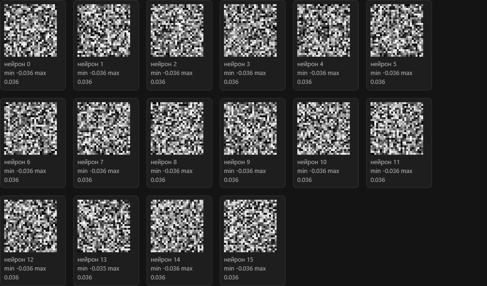
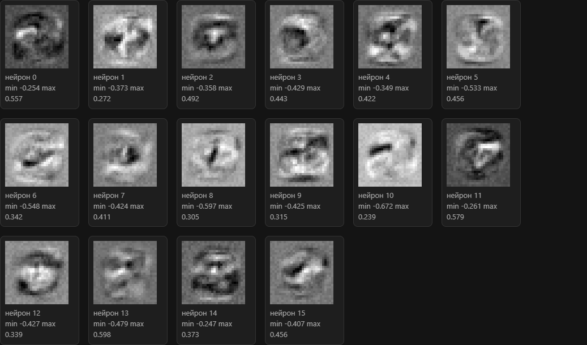

# mnist-digits

Локальное повторение сети из ролика 3Blue1Brown [But what is a Neural Network?](https://www.youtube.com/watch?v=aircAruvnKk) (Deep learning, глава 1). Рукописные цифры MNIST, архитектура 784 → 16 → 16 → 10.

После 10 эпох сеть верно называет **92,4 %** картинок из отложенных 10 000. Эти картинки в обновление весов не входили. Таблица по эпохам и настройки прогона: [experiment.md](experiment.md).

## Снимки первого слоя

Один и тот же слой, 16 нейронов. До обучения это шум, после 10 эпох у нейронов появляются штрихи, но не целые цифры.

- [До обучения](docs/first-hidden-layer-untrained.png)
- [После 10 эпох](docs/first-hidden-layer.png)





## Что делает проект

Сеть учится на 60 000 картинках. Экзамен идёт по другим 10 000. `train.py` пишет кадр весов каждые 10 шагов и в конце каждой эпохи в `output/history/`. Последний кадр дублируется в `output/checkpoint.pt`.

Страница весов листает эту историю ползунком. У первого слоя серая шкала одна на все кадры и взята с последнего, поэтому ранний шаг почти серый, а штрихи видны в конце. У второго слоя и выхода рядом с цветом веса стоят изменение с первого кадра и таблица самих чисел.

В git нет скачанного MNIST, каталога `output/history/` и файла `output/checkpoint.pt`. После клонирования страница показывает случайные начальные веса, пока не запущен `train.py`. Снимки первого слоя сохранены в репозитории отдельно, чтобы результат прогона был виден без этих файлов.

## Стек

- Python 3, PyTorch (CPU-сборки достаточно: в сети около 13 000 параметров)
- Картинки: torchvision, датасет MNIST
- Сетка примеров: matplotlib
- Страница весов: `http.server` из стандартной библиотеки

## Установка

Из папки проекта, PowerShell:

```powershell
python -m venv .venv
.venv\Scripts\Activate.ps1
pip install torch torchvision --index-url https://download.pytorch.org/whl/cpu
pip install matplotlib
```

Полная сборка PyTorch с CUDA на Windows весит гигабайты и здесь не нужна.

## Запуск

Разбор данных, без обучения. Пишет `output/report.txt` и `output/samples.png`.

```powershell
python explore_data.py
```

Страница весов: http://127.0.0.1:8765/ . Остановить сервер: Ctrl+C.

```powershell
python web.py
```

Обучение, около двух минут на CPU. Если страница открыта, ползунок на последнем кадре двигается сам: кадр пишется каждые 10 шагов и в конце каждой эпохи.

```powershell
python train.py
```

## Источники

- Ролик: [But what is a Neural Network?](https://www.youtube.com/watch?v=aircAruvnKk), [плейлист серии](https://www.youtube.com/playlist?list=PLZHQObOWTQDN52m7Y21ePrTbvXkPaWVSg)
- Книга, на которую ролик опирается за кодом и данными: [Neural Networks and Deep Learning](http://neuralnetworksanddeeplearning.com/), Майкл Нильсен
- Датасет: [MNIST](http://yann.lecun.com/exdb/mnist/), Лекун, Кортес, Буржес
